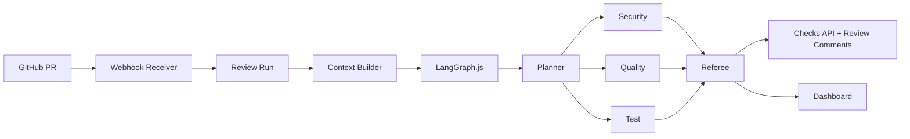

# RepoCouncil Architecture

RepoCouncil combines deterministic GitHub integration with a LangGraph.js multi-agent review workflow.

## Flow

## Principles

- Agents are read-only by default.
- Patch and test suggestions are advisory.
- Evidence-backed findings outrank unsupported model guesses.
- Output should be concise enough for a real pull request.
- Secrets and private notes stay outside GitHub.
